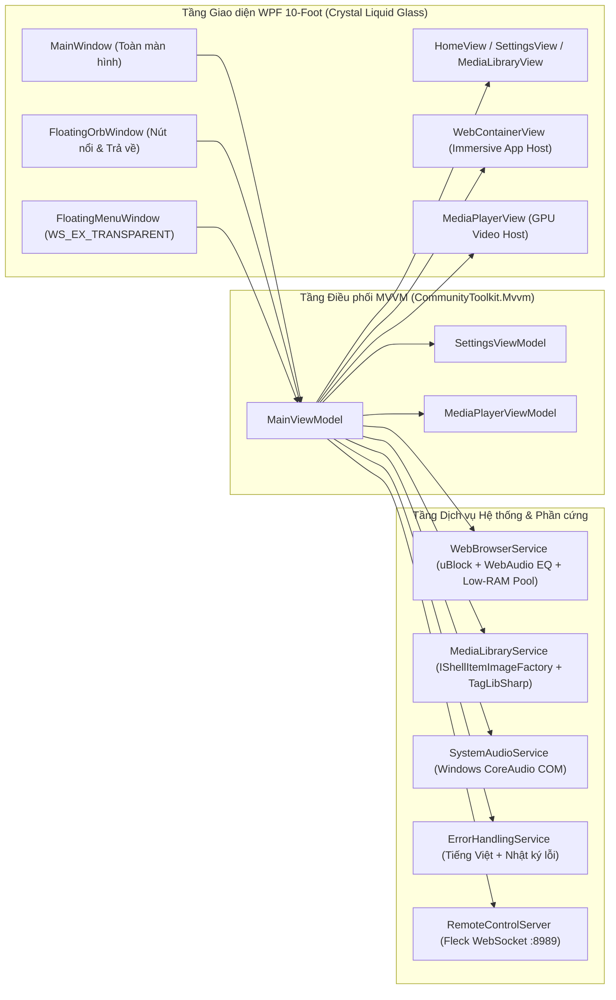

<div align="center">

# ZenBox

**Trung tâm Giải trí Gia đình Chuẩn 10-Foot Smart TV UI trên Windows 11**  
*Thiết kế Crystal Liquid Glass • Chạy ứng dụng tràn viền như Native App • Chặn quảng cáo 2 lớp • Âm thanh EQ 10 dải tần*

[-0078D4?style=for-the-badge&logo=windows11&logoColor=white)](https://github.com/tomyrese/ZenBox)
[](https://dotnet.microsoft.com/)
[](./ZenBox-Skills/skills/03-core-architecture.md)
[](./ZenBox/Services/WebBrowserService.cs)
[](#kiểm-thử-tự-động--đảm-bảo-chất-lượng)

</div>

---

## Giới thiệu

**ZenBox** biến bất kỳ máy tính bàn, laptop hoặc Mini PC chạy Windows 11 nối TV thành một **hệ điều hành giải trí phòng khách (10-Foot TV Interface)** hiện đại, mượt mà và cực kỳ dễ sử dụng cho cả ông bà, bố mẹ lẫn trẻ nhỏ.

Khác với việc mở trình duyệt web thông thường nhiều chữ nhỏ và quảng cáo phiền nhiễu, **ZenBox** mang lại không gian kính pha lê **Crystal Liquid Glass** cỡ lớn 100% Tiếng Việt tự nhiên, tự động mở các dịch vụ giải trí ở chế độ **tràn viền toàn màn hình như ứng dụng gốc**, tích hợp sẵn **uBlock Origin**, bộ cân bằng âm thanh **DSP 10 dải tần**, chế độ **lọc ánh sáng xanh ban đêm** và trình phát phim phần cứng **GPU**.

---

## Điểm nhấn Công nghệ & Tính năng

### 1. Giao diện Crystal Liquid Glass & Pure-Logo 10-Foot UI
- **Vật liệu kính pha lê tối đa tầng:** Khúc xạ ánh sáng nền Aurora sống động với đường chỉ sáng đỉnh kính `1px` sắc nét, độ tương phản cao chống mỏi mắt trong phòng tối.
- **Vật lý chuyển động 60–120 FPS:** Hiệu ứng nhấc nổi (`QuinticEase` / `QuarticEase`) kết hợp quầng sáng thương hiệu trên GPU, không giật khung hình và không cắt viền.
- **Kho 14 ứng dụng trực tuyến cân đối:** **YouTube**, **Netflix**, **Spotify**, **TikTok**, **Facebook**, **FPT Play**, **VTV Go**, **Zing MP3**, **Apple Music**, **Prime Video**, **Instagram**, **SoundCloud**, **Twitch** và **Tìm kiếm Google**, hiển thị bằng **Logo Vector đa lớp thuần khiết** độ phân giải cao.

### 2. Chế độ Ứng dụng Tràn viền Bản địa (*Immersive Native App Mode*)
- **Tràn viền 100% màn hình:** Tự động ẩn toàn bộ thanh trạng thái và thanh địa chỉ khi vào ứng dụng giải trí, đi kèm màn hình khởi động **Native App Splash** mượt mà.
- **Tối ưu hóa giao diện bên trong:** Tiêm kịch bản `NativeAppMode` trước khung hình đầu tiên để ẩn thanh cuộn thô, tắt kéo thả nhầm và loại bỏ các biểu ngữ gạ cài đặt ứng dụng.
- **Hỗ trợ đầy đủ DRM bản quyền:** Tích hợp quyền `ProtectedMediaIdentifier` (`Widevine` / `PlayReady`) và tự động lưu phiên đăng nhập cho **Netflix**, **Spotify**, **Apple Music**.

### 3. Lá chắn Chặn Quảng cáo 2 Lớp (*Dual-Layer Ad-Shield*)
- **Lớp 1 — Tiện ích uBlock Origin chính thức:** Tự động nạp trực tiếp gói mở rộng `uBlock Origin` vào hồ sơ `CoreWebView2` ngay dưới nền khi khởi động.
- **Lớp 2 — Bộ lọc tên miền tầng mạng:** Chặn trực tiếp ở cấp độ yêu cầu mạng đối với các máy chủ phân phối quảng cáo và theo dõi phổ biến mà không làm ảnh hưởng đến băng thông luồng video 4K.

### 4. Cụm Nút Nổi Không Nháy Hình (*Zero-Flicker Assistive Pod*)
- **Xử lý triệt để giới hạn HWND Airspace:** Tách riêng cụm nút nổi (`FloatingOrbWindow`) và bề mặt Trung tâm điều khiển (`FloatingMenuWindow`) giữ cố định trong VRAM kết hợp cờ nhân Windows `WS_EX_TRANSPARENT`, giúp đóng/mở **0ms không nháy hình** đè lên trên cả `WebView2` và `LibVLC`.
- **Nút Trả Về thông minh (`←`):** Tự động xuất hiện ngay khi vào ứng dụng con — lùi trang nếu đang xem sâu bên trong ứng dụng, hoặc đưa thẳng về **Trang Chủ ZenBox** khi ở trang gốc.

### 5. Âm thanh EQ 10 Dải Tần, Rạp Phim Offline & Sức khỏe Thị giác
- **DSP Equalizer 10 dải tần đồng bộ kép:** 6 cấu hình âm học (*Chuẩn cân bằng, Rạp chiếu phim, Rõ lời thoại, Nhạc trữ tình ấm, Tăng âm trầm, Ban đêm dịu êm*) tác động trực tiếp lên cả nhân **LibVLC** lẫn bộ lọc **WebAudio** trên các kênh trực tuyến.
- **Điều khiển âm lượng tổng Windows 11 (`0–100%`):** Giao tiếp trực tiếp với `IAudioEndpointVolume` (CoreAudio COM) ngay trên thanh trượt kính mờ.
- **Kho Phim & Nhạc Poster Grid không cần FFmpeg:** Quét đệ quy siêu tốc, đọc bìa album bằng `TagLibSharp` và trích xuất ảnh thu nhỏ video trực tiếp từ nhân Windows Shell (`IShellItemImageFactory`), hỗ trợ **tìm kiếm tức thì (`< 1ms`)** và **tự động nhớ phút đang xem dở**.
- **Tiện ích phòng ngủ thông minh:** Màng lọc ánh sáng xanh bảo vệ mắt ban đêm (2 cấp độ ấm) và bộ **Hẹn giờ tự nghỉ (*Sleep Timer*)** có đồng hồ đếm ngược trực quan.

### 6. Tối ưu Hiệu suất & Tiết kiệm Bộ nhớ Thông minh
- **Khởi chạy dưới 1 giây (`~0.85s`):** Biên dịch trước sang mã máy gốc `win-x64` (`PublishReadyToRun=true`), tách 380 plugin giải mã ra khỏi bước giải nén tạm và làm nóng nhân trình duyệt bất đồng bộ sau khung hình đầu tiên.
- **Thu hồi RAM thông minh (`SmartMemorySaver`):** Tự động tạm dừng luồng phát và chuyển các ứng dụng nằm dưới nền sang chế độ `CoreWebView2MemoryUsageTargetLevel.Low` (giảm tới ~70% RAM tiêu thụ mà vẫn giữ nguyên trạng thái trang để chuyển lại tức thì `0ms`), kết hợp giới hạn vòng đệm `LRU`.

---

## Kiến trúc Hệ thống



---

## Cấu trúc Thư mục

```text
ZenBox/
├── ZenBox.sln
├── ZenBox-Skills/skills/                  # Bộ tài liệu quy chuẩn thiết kế & kiến trúc bắt buộc
│   ├── 01-ui-glass-nontech.md             # Tiêu chuẩn 10-Foot UI, cỡ chữ >= 16 & 100% Tiếng Việt
│   ├── 02-vietnamese-error-handling.md    # Tiêu chuẩn báo lỗi bình dân & tự phục hồi
│   └── 03-core-architecture.md            # Tiêu chuẩn kiến trúc MVVM, Airspace & đóng gói
├── ZenBox/                                # Dự án chính (.NET 8.0-windows / WPF)
│   ├── Assets/Extensions/uBlock/          # Tiện ích uBlock Origin (Chromium) tích hợp sẵn
│   ├── Controls/                          # Hộp thoại cảnh báo Liquid Glass
│   ├── Models/                            # Các mô hình dữ liệu, cấu hình & cấu hình âm thanh EQ
│   ├── Services/                          # Trình duyệt, CoreAudio, Shell Thumbnail, WebSocket, Báo lỗi
│   ├── Themes/GlassTheme.xaml             # Hệ thống tài nguyên Crystal Liquid Glass & Vector SVG
│   ├── ViewModels/                        # Tầng xử lý trạng thái MVVM
│   └── Views/                             # Các màn hình chính & cụm cửa sổ nổi trợ năng
└── ZenBox.Tests/                          # Dự án kiểm thử tự động xUnit (.NET 8.0-windows)
```

---

## Phím tắt Bàn phím & Điều khiển TV (AirMouse / Remote)

| Phím / Nút điều khiển | Chức năng thực hiện |
| :--- | :--- |
| `Esc` hoặc `BrowserBack` | Lùi về trang trước trong ứng dụng, hoặc trở về **Trang Chủ** |
| `Alt + Home` hoặc `BrowserHome` | Quay về **Trang Chủ ZenBox** ngay lập tức từ mọi màn hình |
| `Space` hoặc `MediaPlayPause` | Phát / Tạm dừng khi đang xem Phim hoặc nghe Nhạc Offline |
| `←` / `→` *(trong trình phát)* | Tua lùi `15 giây` / Tua tới `15 giây` |

---

## Giao thức Điều khiển Từ xa qua Điện thoại (`WebSocket`)

Khi khởi chạy, **ZenBox** tự động mở máy chủ điều khiển nội bộ tại `ws://<IP-Máy-Tính>:8989` (xem địa chỉ IP cụ thể tại mục **Cài đặt → Thư viện & Hệ thống**). Các ứng dụng di động trong cùng mạng Wi-Fi có thể gửi gói tin JSON theo định dạng:

```json
{ "action": "HOME" }
{ "action": "VOL_UP" }
{ "action": "VOL_DOWN" }
{ "action": "PLAY_PAUSE" }
{ "action": "OPEN_APP", "target": "YOUTUBE | NETFLIX | SPOTIFY | TIKTOK | FPTPLAY | VTVGO | MOVIES | MUSIC" }
```

---

## Hướng dẫn Biên dịch, Kiểm thử & Đóng gói `.exe`

### Yêu cầu môi trường
- Hệ điều hành: **Windows 10 / Windows 11 (64-bit)**
- Bộ công cụ phát triển: **.NET 8.0 SDK** trở lên
- **Microsoft Edge WebView2 Runtime** *(được cài đặt sẵn mặc định trên mọi bản Windows 11)*

### 1. Biên dịch & Chạy kiểm thử tự động

```powershell
dotnet build ZenBox.sln -c Release
dotnet test ZenBox.sln -c Release
```

### 2. Xuất bản gói chạy độc lập tốc độ cao (`ReadyToRun Single-File`)

```powershell
dotnet publish ZenBox/ZenBox.csproj `
    -c Release `
    -r win-x64 `
    --self-contained true `
    -p:PublishSingleFile=true `
    -p:IncludeNativeLibrariesForSelfExtract=true `
    -p:PublishReadyToRun=true `
    -p:DebugType=None `
    -p:DebugSymbols=false `
    -o ./publish
```

Sau khi xuất bản hoàn tất, khởi chạy trực tiếp tệp `./publish/ZenBox.exe` *(lưu ý giữ thư mục `Assets/` và `libvlc/` đi kèm cạnh `ZenBox.exe` khi sao chép sang máy tính khác)*.

---

## Kiểm thử Tự động & Đảm bảo Chất lượng

Dự án duy trì bộ **19 bài kiểm thử tự động (xUnit)** chạy nghiệm thu nghiêm ngặt:
- **`UiComplianceTests`**: Quét tự động toàn bộ mã nguồn `.xaml` bằng cả Regex lẫn XML Parser, đảm bảo không tồn tại bất kỳ cỡ chữ nào nhỏ hơn `16px` và không rò rỉ thuật ngữ kỹ thuật tiếng Anh lên giao diện người dùng.
- **`AssetVerificationTests`**: Xác minh tính toàn vẹn của `uBlock Origin (manifest.json)` ở cả thư mục nguồn lẫn bản đóng gói, cùng độ chính xác của bộ lọc chặn quảng cáo tầng mạng.
- **`BrandLogoFactoryTests`**: Kiểm tra toàn bộ 19 biểu tượng Vector đa lớp ở trạng thái `Frozen` tối ưu GPU, bộ 6 cấu hình âm thanh 10 dải tần và đồng bộ trạng thái các nút trong Trung tâm Cài đặt.
- **`ErrorHandlingServiceTests` & `MediaLibraryServiceTests`**: Đảm bảo ánh xạ chuẩn xác 4 nhóm thông báo tiếng Việt thân thiện, ghi nhật ký `logs/error_YYYYMMDD.txt` và lọc đúng định dạng đa phương tiện.

---

<div align="center">
Phát triển tối ưu dành riêng cho trải nghiệm giải trí gia đình trên <b>Windows 11</b>.
</div>
